  

# ⚡ Awesome High-Speed In-Memory Cache & Key-Value Store

  
  
  
  
  
  
  

> 🚀 **A curated, battle-tested directory of high-speed in-memory caches, distributed key-value stores, ultra-low-latency data grids, embedded storage engines, and managed cloud caching platforms.**

Whether you are scaling high-throughput APIs, slashing database tail latencies, designing real-time financial trading systems, or building distributed microservices, this repository covers the best-of-breed open-source tools and fully-managed SaaS platforms.

---

## 📑 Table of Contents

- [📊 Sector Overview & Market Dynamics](#-sector-overview--market-dynamics)
- [☁️ SaaS & Hosted Platforms](#️-saas--hosted-platforms)
- [🔓 Open-Source Equivalents & Tools](#-open-source-equivalents--tools)
  - [⚡ Redis-Compatible & Multi-Threaded In-Memory Stores](#-redis-compatible--multi-threaded-in-memory-stores)
  - [🌐 Distributed In-Memory Data Grids & Low-Latency Stores](#-distributed-in-memory-data-grids--low-latency-stores)
  - [📨 High-Throughput Memcached-Protocol & Sharded Caches](#-high-throughput-memcached-protocol--sharded-caches)
  - [📦 Embedded & In-Process High-Speed Key-Value Libraries](#-embedded--in-process-high-speed-key-value-libraries)
  - [💾 Persistent & Hybrid Flash/RAM Key-Value Engines](#-persistent--hybrid-flashram-key-value-engines)
- [📈 Star History](#-star-history)
- [🤝 Contributing](#-contributing)
- [💖 Support & Sponsorship](#-support--sponsorship)

---

## 📊 Sector Overview & Market Dynamics

The global in-memory database and caching market is estimated at **$7.5 billion to $8.2 billion in 2024**, projected to surpass **$21 billion by 2030** at an annual CAGR exceeding 19%. The sector exhibits **moderate fragmentation with strong hyperscaler concentration**: hyperscalers (AWS, Microsoft Azure, Google Cloud) command roughly 55–65% of managed deployments, while specialized independent vendors (Redis, Aerospike, Hazelcast, Couchbase) and high-performance open-source entrants (Valkey, Dragonfly, Garnet) capture the remainder driven by ultra-low tail latency, open-governance requirements, and high-density hardware efficiency.

---

## ☁️ SaaS & Hosted Platforms

Below is a comparison of commercial, fully managed, and serverless in-memory caching solutions, sorted in descending order by **company market capitalization / enterprise valuation**.

| Provider / Product 🏢 | Valuation / Market Size 💰 | Pricing Model & Starting Tier 💳 | Free Tier / Free Trial Limits 🎁 | Description 📝 |
| :--- | :--- | :--- | :--- | :--- |
| **[Microsoft Azure Cache for Redis](https://azure.microsoft.com/en-us/products/cache/)** | ~$3.1 Trillion *(Market Cap)* | From $0.022/hour (~$16.06/month) for Basic C0 (250 MB cache instance) | $200 free credit across first 30 days + 12 months access to selected free services | Fully managed, secure Redis cache service featuring enterprise active-active geo-replication, sub-millisecond latency, and Redis Enterprise modules. |
| **[Google Cloud Memorystore](https://cloud.google.com/memorystore)** | ~$2.1 Trillion *(Alphabet Market Cap)* | From $0.0247/GB-hour (~$17.78/month) for Basic M1 (1 GB Redis/Valkey tier) | $300 free trial credit valid for 90 days across Google Cloud services | Highly available, fully managed in-memory data store service for Redis, Valkey, and Memcached with automatic patching and 99.9% SLA. |
| **[AWS ElastiCache](https://aws.amazon.com/elasticache/)** | ~$2.0 Trillion *(Amazon Market Cap)* | From $0.016/hour (~$11.52/month) for `cache.t4g.micro` node (0.5 GiB RAM) | 750 hours/month of `cache.t2.micro` or `cache.t3.micro` free for 12 months under AWS Free Tier | Scalable in-memory data store supporting Valkey, Redis OSS, and Memcached with microsecond latency and serverless autoscaling modes. |
| **[Redis Cloud](https://redis.io/cloud/)** | ~$4.0 Billion *(Private Valuation)* | From $5.00/month for Fixed 100 MB Plan (or $0.881/GB-hour on Flexible pay-as-you-go) | Free Forever: 1 database, 30 MB storage limit, maximum 30 concurrent client connections | Fully managed multi-cloud enterprise Redis service with multi-region 99.999% availability, Vector Search, and JSON capabilities. |
| **[Aerospike Cloud](https://aerospike.com/products/cloud/)** | ~$1.2 Billion *(Private Valuation)* | From $0.21/hour (~$150/month) for starter managed cluster deployment | 14-day free trial with full feature access and up to 50 GB data allocation | Managed real-time NoSQL database using Hybrid Memory Architecture (HMA) combining in-memory speed with NVMe flash capacity. |
| **[Couchbase Capella](https://www.couchbase.com/products/capella/)** | ~$800 Million *(Market Cap)* | From $0.258/hour (~$185/month) per node for developer / evaluation instances | 30-day free trial including 1 hosted cluster, pre-loaded sample datasets, no credit card required | Fully managed, memory-first cloud NoSQL document and key-value database providing sub-millisecond data access and built-in caching. |
| **[Hazelcast Viridian Cloud](https://hazelcast.com/products/viridian/)** | ~$350 Million *(Private Valuation)* | From $0.08/GB-hour on pay-as-you-go serverless cluster configurations | Free Forever: 1 serverless cluster with up to 1 GB memory capacity and 250k operations/month | Serverless distributed in-memory compute and storage platform engineered for streaming event processing and real-time operational caching. |
| **[Dragonfly Cloud](https://www.dragonflydb.io/cloud)** | ~$150 Million *(Venture Backed)* | From $0.038/hour (~$28/month) for 1 GB dedicated instance | 14-day free trial on dedicated cloud clusters with up to 4 GB instance capacity | Fully managed cloud service for Dragonfly, running ultra-high-throughput multi-threaded Redis/Memcached compatible engines. |
| **[Momento Cache](https://www.gomomento.com/)** | ~$60 Million *(Venture Backed)* | True serverless pay-per-use at $0.0000005 per request ($0.50 per 1M requests) + $0.15/GB-month storage | Free Forever: 5 GB-months of data cache storage and up to 50 million read/write operations each month | Instant, truly serverless distributed cache with zero cluster configuration, automatic elasticity, and global edge points of presence. |

---

## 🔓 Open-Source Equivalents & Tools

High-performance open-source caching servers, multi-threaded key-value stores, distributed data grids, and embedded memory engines. Sorted within each category by **GitHub Stargazers** (descending).

### ⚡ Redis-Compatible & Multi-Threaded In-Memory Stores

| Project 🛠️ | GitHub_Stars ⭐ | Description 📝 |
| :--- | :--- | :--- |
| **[Redis](https://github.com/redis/redis)** |  | The quintessential in-memory data structure store used as a cache, message broker, and streaming engine. |
| **[Dragonfly](https://github.com/dragonflydb/dragonfly)** |  | Modern multi-threaded, shared-nothing in-memory datastore fully compatible with Redis & Memcached APIs at up to 25x throughput. |
| **[Valkey](https://github.com/valkey-io/valkey)** |  | High-performance open-source fork of Redis curated under the Linux Foundation supporting multi-threaded I/O, clustering, and rich data types. |
| **[KeyDB](https://github.com/Snapchat/KeyDB)** |  | High-performance, multithreaded drop-in replacement for Redis maintained by Snap with active-active replication and FLASH storage support. |
| **[Garnet](https://github.com/microsoft/garnet)** |  | Remote cache-store written by Microsoft Research in C#/.NET offering extreme throughput, microsecond tail latencies, and RESP compatibility. |
| **[Apache Kvrocks](https://github.com/apache/kvrocks)** |  | Distributed key-value NoSQL database compatible with the Redis protocol that leverages RocksDB on flash storage to dramatically reduce memory costs. |
| **[Redict](https://redict.io)** |  | Independent, copyleft-licensed (LGPL-3.0) community-driven in-memory database maintaining reliable Redis protocol compatibility. |

---

### 🌐 Distributed In-Memory Data Grids & Low-Latency Stores

| Project 🛠️ | GitHub_Stars ⭐ | Description 📝 |
| :--- | :--- | :--- |
| **[etcd](https://github.com/etcd-io/etcd)** |  | Strongly consistent, distributed in-memory key-value store providing reliable shared configuration and service discovery across clusters. |
| **[Hazelcast](https://github.com/hazelcast/hazelcast)** |  | Open-source distributed in-memory compute and storage platform providing partitioned key-value maps, queues, and streaming pipelines. |
| **[Apache Ignite](https://github.com/apache/ignite)** |  | Distributed, memory-centric database, caching, and computational grid supporting SQL, key-value APIs, and ACID transactions. |
| **[Tarantool](https://github.com/tarantool/tarantool)** |  | Ultra-fast in-memory computing platform combining a Lua application server with transactional key-value/document persistence. |
| **[Apache Geode](https://github.com/apache/geode)** |  | Low-latency, distributed in-memory data management system providing high-concurrency transactional data access across memory pools. |
| **[Infinispan](https://github.com/infinispan/infinispan)** |  | Open-source distributed in-memory key-value data store and cache in Java with multi-protocol support (REST, Hot Rod, Memcached). |

---

### 📨 High-Throughput Memcached-Protocol & Sharded Caches

| Project 🛠️ | GitHub_Stars ⭐ | Description 📝 |
| :--- | :--- | :--- |
| **[Memcached](https://github.com/memcached/memcached)** |  | The industry-standard, lightweight, distributed memory object caching system engineered for raw performance and simplicity. |
| **[Groupcache](https://github.com/golang/groupcache)** |  | Distributed caching and cache-filling Go library engineered as a coordinated peer-to-peer replacement for a pool of Memcached nodes. |
| **[Mcrouter](https://github.com/facebook/mcrouter)** |  | Meta's high-performance Memcached protocol router used for connection pooling, sharding, failover routing, and multi-cluster scaling. |
| **[Pelikan](https://github.com/pelikan-io/pelikan)** |  | Unified, modular cache framework in C/Rust developed by Twitter/X for predictable microsecond latency and hardware efficiency. |

---

### 📦 Embedded & In-Process High-Speed Key-Value Libraries

| Project 🛠️ | GitHub_Stars ⭐ | Description 📝 |
| :--- | :--- | :--- |
| **[Caffeine](https://github.com/ben-manes/caffeine)** |  | High-performance, near-optimal in-memory caching library for Java utilizing Window TinyLFU eviction policies. |
| **[BigCache](https://github.com/allegro/bigcache)** |  | Fast, concurrent, evicting in-memory cache written in Go capable of holding millions of entries without garbage collection pauses. |
| **[Ristretto](https://github.com/dgraph-io/ristretto)** |  | High-performance, memory-bound concurrent cache in Go designed for high hit ratios, TinyLFU admission, and contention-free concurrency. |
| **[FreeCache](https://github.com/coocood/freecache)** |  | Zero-GC Go cache library capable of storing hundreds of millions of entries in memory with ring-buffer storage and ring hashing. |
| **[DashMap](https://github.com/xacrimon/dashmap)** |  | Blazingly fast concurrent hash map implementation for Rust providing fine-grained sharded locking outperforming `RwLock<HashMap>`. |
| **[Moka](https://github.com/moka-rs/moka)** |  | Fast, concurrent cache library for Rust inspired by Caffeine, featuring TinyLFU eviction, async runtime support, and TTL expiration. |

---

### 💾 Persistent & Hybrid Flash/RAM Key-Value Engines

| Project 🛠️ | GitHub_Stars ⭐ | Description 📝 |
| :--- | :--- | :--- |
| **[RocksDB](https://github.com/facebook/rocksdb)** |  | High-performance embedded key-value storage engine in C++ based on LSM-trees, engineered for fast flash storage and server workloads. |
| **[TiKV](https://github.com/tikv/tikv)** |  | CNCF-graduated distributed, transactional key-value database built in Rust providing horizontal scalability, Raft consensus, and ACID transactions. |
| **[BadgerDB](https://github.com/dgraph-io/badger)** |  | Embeddable, persistent, fast key-value store in Go implementing WiscKey paper architecture with separated keys and values for SSD optimization. |
| **[FASTER](https://github.com/microsoft/FASTER)** |  | Concurrent, latch-free key-value store and log in C++/C# from Microsoft Research supporting larger-than-memory datasets with epoch synchronization. |
| **[Pebble](https://github.com/cockroachdb/pebble)** |  | High-throughput, RocksDB-compatible LSM-tree key-value store in Go developed by Cockroach Labs for distributed database storage backends. |
| **[LMDB](https://github.com/LMDB/lmdb)** |  | Lightning Memory-Mapped Database: ultra-fast, zero-copy, embeddable B+tree key-value engine with full ACID compliance and lockless reads. |
| **[Aerospike Community Edition](https://github.com/aerospike/aerospike-server)** |  | High-speed distributed real-time NoSQL key-value database utilizing RAM index pointers alongside direct NVMe block flash storage. |

---

## 📈 Star History

---

## 🤝 Contributing

Contributions are warmly welcomed! Help keep this curated resource fresh, comprehensive, and accurate.

1. 🍴 Fork the repository.
2. 🌿 Create a feature branch (`git checkout -b feature/awesome-cache-addition`).
3. ✏️ Add your open-source cache or high-speed storage engine with a concise description and correct Stars_Badge.
4. 🚀 Commit your changes (`git commit -m 'Add awesome cache project'`).
5. 📬 Open a Pull Request.

Please check that submissions are actively maintained, relevant to in-memory caching or high-speed key-value storage, and categorized appropriately.

---

## 💖 Support & Sponsorship

If you found this curated list helpful for benchmarking, engineering design, or infrastructure research, please consider supporting the project:

- ⭐ **Star this repository** to help others discover it!
- 🍴 **Fork it** to bookmark and experiment with your own stack.
- 📢 **Share it** with fellow backend, systems, and DevOps engineers.
- ☕ **Support & Buy a Coffee:** You can sponsor ongoing maintenance and open-source research via the [GitHub Sponsor Dashboard](https://github.com/sponsors/ishandutta2007). Your support is greatly appreciated!
